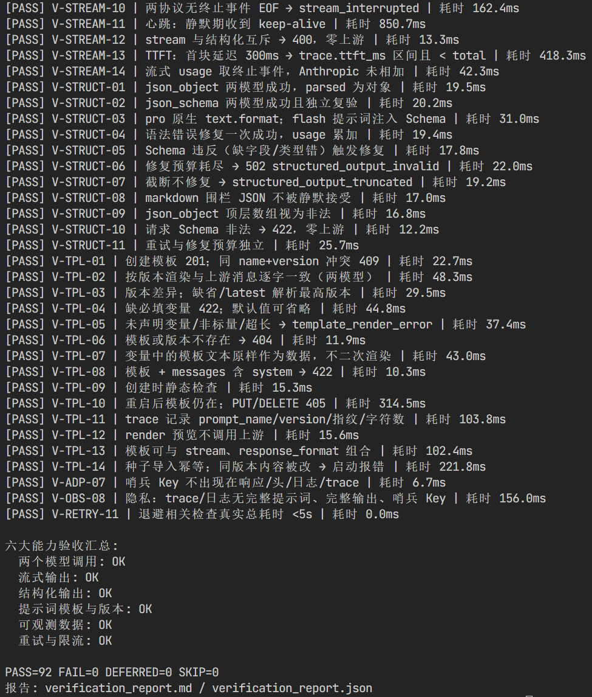

<h1 align="center">LLM Gateway</h1>

<p align="center">统一大模型网关 · 单一入口 · 双协议适配 · 生产级可观测与治理</p>

<p align="center">
  
  
  
  
  
</p>

<p align="center">
  对外只暴露一个 OpenAI Chat Completions 风格入口，对内通过适配器调用两种上游协议；<br>
  自带流式、结构化输出、提示词模板与版本、可观测性、指数退避重试、按模型限流六项能力，并由 92 项自动化检查自证。
</p>

---

## 目录

- [为什么需要它](#为什么需要它)
- [功能特性](#功能特性)
- [架构](#架构)
- [快速开始](#快速开始)
- [使用](#使用)
- [配置](#配置)
- [错误码](#错误码)
- [可观测性插件](#可观测性插件)
- [扩展指南](#扩展指南)
- [已知局限](#已知局限)
- [文档](#文档)
- [验证与质量](#验证与质量)

## 为什么需要它

多模型并存时，真正的成本不在"调通"，而在协议差异、参数治理、失败处置和成本归因：

- **协议差异收敛在 `providers/` 一层**。业务代码只认内部类型（`UnifiedRequest` / `UnifiedResponse` / `StreamEvent` / `Usage`），供应商原始对象、事件名、鉴权方式不上浮。新增协议 = 新增一个适配器 + 注册一行。
- **不做透明代理**。入口 `extra=forbid`，所有字段经校验、归一化后重新构造，客户端请求头一律不转发；参数治理、统一错误语义和成本统计才不会在转发中丢失。
- **HTTP 200 不等于成功**。按网络 → HTTP → 协议 → 业务四层判定，200 但不可解析或空文本一律判失败。
- **错误先分类，再决定是否重试**。只重试网络抖动、超时、429、5xx；截断、拒答、格式错误重试无意义，交给结构化修复预算处理。
- **可观测性插件化**。业务只发事件，`observability/` 订阅落库；删除该目录或关闭开关，网关功能不受影响。

## 功能特性

| 能力 | 实现要点 | 验证编号 |
| --- | --- | --- |
| 统一入口与路由 | 逻辑模型名 → 协议适配器，配置驱动；未知模型 404 并列出可用模型；能力不满足在入口 400 | `V-ROUTE-*` |
| 双协议适配 | OpenAI Responses（`deepseek-v4-pro`）与 Anthropic Messages（`deepseek-v4-flash`），Usage 归一化，缺 usage 不估算 | `V-ADP-*` |
| 流式输出 | SSE 增量下发的真流式，首个文本 delta 为提交点；提交前失败可重试，提交后失败发 `event: error`；客户端断开穿透到上游并取消 | `V-STREAM-*` |
| 结构化输出 | `json_object` / `json_schema`；原生字段与"提示词注入 + 本地校验"两条路径，最终都本地校验；有限修复循环（默认 2 次） | `V-STRUCT-*` |
| 提示词模板与版本 | SemVer 版本不可变、`latest` 解析、单次扫描渲染（无模板注入）、创建时静态检查、SQLite 持久化 + 种子幂等导入 | `V-TPL-*` |
| 可观测数据 | 每次请求恰好一条 trace：Token 分类、total/TTFT/generation 拆分延迟、重试与修复计数、模板指纹；不含提示词与输出正文 | `V-OBS-*` |
| 指数退避重试 | `d_n = min(max_delay, base × factor^(n-1))`，支持 `Retry-After` 与总预算约束；时钟/sleep/rng 可注入 | `V-RETRY-*` |
| 按模型限流 | 每个逻辑模型独立令牌桶，超限返回 429 + `Retry-After`；模型之间互不影响；进程内实现 | `V-RL-*` |

## 架构

```
客户端
  │  POST /v1/chat/completions（统一 schema，extra=forbid）
  ▼
api（请求校验 / SSE 编码 / 错误信封）
  │
  ▼
services（ChatService：路由 → 限流 → 模板 → 能力检查 → 上游调用/重试/修复）
  │                 │
  │                 ├─ services/router      逻辑模型 → ModelSpec
  │                 ├─ services/prompts     模板存储/渲染/版本
  │                 └─ services/structured  JSON Schema 校验与修复循环
  ▼
providers（Provider 抽象 + 两个适配器 + http_errors 映射）
  ├─ openai_responses  → POST {base_url}/responses
  └─ anthropic_messages → POST {base_url}/v1/messages

core：类型 / 错误 / 事件总线 / 重试 / 令牌桶 / 时钟
observability（插件，仅 main.py 装配）：订阅事件 → 有界队列 → SQLite → /admin/observability/*
```

依赖方向：`api → services → providers / core`，下层不得 import 上层；业务层不 import `observability`；供应商原始事件与对象不出 `providers` 层。

```
.
├─ config/            gateway.yaml · gateway.demo.yaml · gateway.verify.yaml · prompts/*.yaml
├─ docs/              blueprint/（架构、契约、设计、错误码、验证计划、决策）· targets.md · review-log.md
├─ scripts/           verify_all.py · run_gateway.py · run_mock_upstream.py · showcase.py · chat_turns.py
├─ src/gateway/
│  ├─ main.py         组合根（唯一同时装配业务与 observability 的地方）
│  ├─ config.py       配置模型与加载（env 校验、快速失败）
│  ├─ api/            routes_chat · routes_prompts · routes_misc · routes_sse_stream · sse · error_handlers · schemas
│  ├─ core/           types · errors · events · retry · ratelimit · clock
│  ├─ services/       chat_service · router · structured · prompts
│  ├─ providers/      base · registry · openai_responses · anthropic_messages · sse_parser · http_errors
│  └─ observability/  plugin · recorder · store · routes · stats
└─ tests/             unit/ · mock_upstream/
```

## 快速开始

### 环境要求

- Python ≥ 3.11
- 无需数据库、消息队列；SQLite 使用标准库

### 安装

```bash
python -m venv .venv
# Windows
.venv\Scripts\activate
.venv\Scripts\pip install -e ".[dev]"
# macOS / Linux
source .venv/bin/activate
pip install -e ".[dev]"
```

> **终端约定**：下文命令里的 `python` 均指"已激活虚拟环境后的解释器"。不想激活、或 PowerShell 执行策略受限时，可统一换成解释器全路径：
>
> - Windows：`.\.venv\Scripts\python.exe`
> - macOS / Linux：`.venv/bin/python`
>
> 例如 `python scripts\verify_all.py` 等价于 `.\.venv\Scripts\python.exe scripts\verify_all.py`。若看到 `ModuleNotFoundError: No module named 'httpx'`，说明用了全局 Python（venv 未激活），换成全路径形式重跑即可。

> **Windows / PowerShell 说明**：下文 `export X=Y` 需写成 `$env:X="Y"`；`curl` 请显式使用 `curl.exe`（PowerShell 中 `curl` 是 `Invoke-WebRequest` 别名），且内联 JSON（尤其含空格或嵌套对象时）的引号解析不可靠——把请求体写入文件后用 `curl.exe ... --data-binary "@body.json"` 最稳妥，或直接在 Git Bash / WSL 中执行下述 bash 示例。

### 3 分钟跑通（本地 mock，无需真实 Key）

终端 A —— mock 上游：

```bash
export DEMO_UPSTREAM_KEY=demo-local-key
python scripts/run_mock_upstream.py --port 9001
```

终端 B —— 网关：

```bash
export DEMO_UPSTREAM_KEY=demo-local-key
python scripts/run_gateway.py --config config/gateway.demo.yaml --port 8010
```

终端 C —— 验证：

```bash
curl -s http://127.0.0.1:8010/healthz
curl -s -X POST http://127.0.0.1:8010/v1/chat/completions \
  -H 'Content-Type: application/json' \
  -d '{"model":"deepseek-v4-pro","messages":[{"role":"user","content":"hi"}],"max_tokens":128}'
```

### 连接真实上游

```bash
export DEEPSEEK_API_KEY=sk-...
python scripts/run_gateway.py --config config/gateway.yaml --port 8000
```

启动前必须设置模型 `api_key_env` 指向的环境变量；缺失会在启动时快速失败并列出变量名。

### 一键全量验证

```bash
python scripts/verify_all.py --no-live    # 离线 91 项，不需要真实 Key
python scripts/verify_all.py              # 全量 92 项，含真实上游 live 冒烟
```

## 使用

### 请求与响应

统一入口 `POST /v1/chat/completions`，未知字段一律 422 并指出字段路径。

- `messages` 与 `prompt` 至少给一个；两者同时给出时，模板渲染的消息在前、`messages` 追加在后，且 `messages` 不得含 `system`
- `stream=true` 与 `response_format.type≠text` 互斥（400 `unsupported_parameter_combination`）
- 非流式响应 `choices[0].message.parsed` 返回结构化结果，`gateway.*` 返回 request_id、重试/修复次数、延迟与模板版本
- 流式响应为标准 SSE：首块 `role` → 若干 `content` delta → 末块 `finish_reason + usage + gateway` → `data: [DONE]`；空闲超过心跳间隔发 `: keep-alive`

```bash
API=http://127.0.0.1:8010

# 健康检查 / 模型列表
curl -s $API/healthz
curl -s $API/v1/models

# 非流式：pro（OpenAI Responses）与 flash（Anthropic Messages）
curl -s -X POST $API/v1/chat/completions -H 'Content-Type: application/json' \
  -d '{"model":"deepseek-v4-pro","messages":[{"role":"user","content":"hi"}],"max_tokens":128}'
curl -s -X POST $API/v1/chat/completions -H 'Content-Type: application/json' \
  -d '{"model":"deepseek-v4-flash","messages":[{"role":"user","content":"hi"}],"max_tokens":128}'

# 流式（SSE）
curl -sN -X POST $API/v1/chat/completions -H 'Content-Type: application/json' \
  -d '{"model":"deepseek-v4-pro","stream":true,"messages":[{"role":"user","content":"hi"}],"max_tokens":128}'
curl -sN -X POST $API/v1/chat/completions -H 'Content-Type: application/json' \
  -d '{"model":"deepseek-v4-flash","stream":true,"messages":[{"role":"user","content":"hi"}],"max_tokens":128}'

# 结构化：json_object / json_schema
curl -s -X POST $API/v1/chat/completions -H 'Content-Type: application/json' \
  -d '{"model":"deepseek-v4-pro","messages":[{"role":"user","content":"give json"}],"max_tokens":128,"response_format":{"type":"json_object"}}'
curl -s -X POST $API/v1/chat/completions -H 'Content-Type: application/json' \
  -d '{"model":"deepseek-v4-flash","messages":[{"role":"user","content":"give json"}],"max_tokens":128,"response_format":{"type":"json_schema","json_schema":{"name":"demo","schema":{"type":"object","required":["ok"],"properties":{"ok":{"type":"boolean"}}},"strict":true}}}'
```

### 端点一览

| 方法 | 路径 | 说明 |
| --- | --- | --- |
| `POST` | `/v1/chat/completions` | 统一入口，流式/非流式、结构化、模板引用 |
| `GET` | `/v1/models` | 逻辑模型列表及能力 |
| `GET` | `/healthz` · `/readyz` | 存活 / 就绪探针 |
| `POST` | `/v1/prompts` | 创建一个新版本（同 name+version 重复返回 409） |
| `GET` | `/v1/prompts` | 模板列表 |
| `GET` | `/v1/prompts/{name}/versions/{version\|latest}` | 查询指定版本 |
| `POST` | `/v1/prompts/{name}/versions/{version\|latest}/render` | 只渲染预览，不调用上游 |
| `GET` | `/admin/observability/traces` | 按 `model` / `status` / `since` / `limit` 过滤 |
| `GET` | `/admin/observability/traces/{request_id}` | 单条 trace |
| `GET` | `/admin/observability/stats` | 按模型聚合的成功率、Token 总和、total/TTFT 分位、错误码计数 |

模板版本不可变，不提供更新与删除（`PUT` / `DELETE` 返回 405）。配置 `auth.enabled=true` 时所有端点要求 `Authorization: Bearer <网关密钥>`，失败返回 401 `auth_failed`。

### 提示词模板

```bash
# 创建模板（版本不可变）
curl -s -X POST $API/v1/prompts -H 'Content-Type: application/json' \
  -d '{"name":"greet","version":"1.0.0","description":"demo template","owner":"demo","changelog":"initial","messages":[{"role":"system","content":"You are {{ role }}."},{"role":"user","content":"Say hello to {{ name }}"}],"variables":[{"name":"role","required":false,"default":"assistant"},{"name":"name","required":true}]}'

# 按版本引用（不写 version 或写 latest = 最高 SemVer）
curl -s -X POST $API/v1/chat/completions -H 'Content-Type: application/json' \
  -d '{"model":"deepseek-v4-pro","max_tokens":128,"prompt":{"name":"code-review","version":"1.1.0","variables":{"code":"print(1)"}}}'

# render 预览（不调用上游）
curl -s -X POST $API/v1/prompts/code-review/versions/latest/render -H 'Content-Type: application/json' \
  -d '{"variables":{"code":"print(1)"}}'
```

渲染是单次扫描替换，不递归、不使用 `eval` / `str.format` / 不受限 Jinja；变量值只作为数据出现在模板指定位置，不会二次渲染。

### 可观测性查询

```bash
curl -s "$API/admin/observability/traces?limit=3"
curl -s "$API/admin/observability/stats"
```

### 限流演示

```bash
# demo-limited 的 burst=2，第 3、4 次返回 429
for i in 1 2 3 4; do
  curl -s -o /dev/null -w "%{http_code}\n" -X POST $API/v1/chat/completions \
    -H 'Content-Type: application/json' \
    -d '{"model":"demo-limited","messages":[{"role":"user","content":"hi"}],"max_tokens":64}'
done
```

### 演示脚本

```bash
# 一次串起六项能力：路由 / 流式 TTFT / 结构化 / 模板版本 / 多轮 / trace+stats
python scripts/showcase.py --base http://127.0.0.1:8010 --mock-url http://127.0.0.1:9001

# 多轮对话客户端
python scripts/chat_turns.py --model deepseek-v4-pro --stream

# README 中的 curl 全部实跑（Windows 下需 Git Bash / WSL）
bash scripts/demo_curl.sh
```

## 配置

环境变量（见 `.env.example`）：

| 变量 | 说明 |
| --- | --- |
| `DEEPSEEK_API_KEY` | 上游 Key，只在 providers 层读取 |
| `DEMO_UPSTREAM_KEY` | 本地 mock/demo 占位 Key，与真实 Key 隔离，可随便填 |
| `GATEWAY_API_KEYS` | 网关自身鉴权 Key（逗号分隔），`auth.enabled=true` 时必需 |

`config/gateway.yaml` 主要字段：

| 字段 | 说明 |
| --- | --- |
| `server` | host / port（`scripts/run_gateway.py` 可用 CLI 覆盖） |
| `auth` | 网关鉴权开关与 Key 环境变量名 |
| `retry` | `max_retries`（默认 3 → 最多 4 次上游调用）、`base_delay_s`、`factor`、`max_delay_s`、`jitter`（none/full/equal） |
| `stream` | `heartbeat_interval_s` |
| `structured` | `max_repairs`（默认 2） |
| `defaults` | 默认超时与限流 |
| `observability` | 开关、SQLite 路径、队列大小 |
| `prompts` | 模板库路径与种子目录 |
| `models` | 逻辑模型 → 协议、base_url、endpoint_path、api_key_env、upstream_model、timeout、rate_limit、capabilities、thinking、default_max_tokens |

`capabilities.native_json_object / native_json_schema` 只决定结构化输出走原生字段还是"提示词注入 + 本地校验"；`stream=false` / `structured_output=false` 会触发 `unsupported_capability`。

## 错误码

统一信封：

```json
{"error":{"code":"...","message":"...","type":"...","stage":"...","retryable":false,"request_id":"...","details":{}}}
```

| code | HTTP | stage | 网关内部是否重试 | 触发 |
| --- | --- | --- | --- | --- |
| invalid_request | 422 | request | 否 | 缺字段 / 未知字段 / 越界 |
| unsupported_parameter_combination | 400 | request | 否 | stream 与结构化同用 |
| invalid_response_format | 422 | request | 否 | 请求 Schema 非法 |
| unsupported_capability | 400 | routing | 否 | 模型不具备所请求能力 |
| model_not_found | 404 | routing | 否 | 未知逻辑模型 |
| auth_failed | 401 | admission | 否 | 网关鉴权失败 |
| rate_limit_exceeded | 429 | admission | 否 | 网关按模型限流（带 Retry-After） |
| template_not_found | 404 | template | 否 | 模板 / 版本不存在 |
| template_variable_missing | 422 | template | 否 | 缺必填变量 |
| template_render_error | 422 | template | 否 | 未声明变量 / 类型非法 / 超长 / 静态检查失败 |
| template_conflict | 409 | template | 否 | 同 name+version 重复创建 |
| upstream_connection_error | 502 | connect | 是 | DNS / 连接失败 / 连接重置 |
| upstream_timeout | 504 | connect | 是 | 连接或读取超时 |
| upstream_rate_limited | 503 | upstream_http | 是 | 上游 429 |
| upstream_server_error | 502 | upstream_http | 是 | 上游 500 / 502 / 504 |
| upstream_overloaded | 503 | upstream_http | 是 | 上游 503 / 529 |
| upstream_auth_error | 502 | upstream_http | 否 | 上游 401 / 403 |
| upstream_insufficient_balance | 502 | upstream_http | 否 | 上游 402 |
| upstream_bad_request | 502 | upstream_http | 否 | 上游 400 / 404 / 422 |
| upstream_protocol_error | 502 | protocol | 否 | 200 但不可解析 / 缺关键字段 |
| upstream_empty_response | 502 | protocol | 否 | 200 但无文本 |
| stream_interrupted | SSE error 帧 | stream | 否 | 流中断 / 无终止事件 |
| structured_output_invalid | 502 | output_validation | 否 | 修复预算耗尽 |
| structured_output_truncated | 502 | output_validation | 否 | max_tokens 截断 |
| internal_error | 500 | internal | 否 | 未预期异常 |

约定：HTTP 429 只代表网关自己的限流，上游 429 一律映射为 `upstream_rate_limited(503)`，客户端可据此区分限流来源；上游错误体解析失败时退回状态码映射；错误摘要脱敏并截断到 300 字符。

## 可观测性插件

- **启用**：`observability.enabled=true`，配置 `db_path` 与 `queue_size`；`/admin/observability/*` 立即可用
- **关闭**：设为 `false`；业务链路照常工作，admin 路由返回 404
- **卸载**：删除 `src/gateway/observability/` 并移除 `src/gateway/main.py` 中的 `install_observability` 装配；`core/events.py` 仍发事件但无订阅者，行为等价于关闭

每次请求恰好一条 trace，包含：Token 分类（input / output / cache_read / cache_creation / reasoning / total）、`latency_total_ms` / `ttft_ms` / `generation_ms` / `pre_upstream_ms` / `retry_wait_ms`、`retry_count` / `repair_count` / `attempts`、`prompt_name` / `prompt_version` / `prompt_fingerprint`。只存指纹与字符数，不保存完整提示词与输出；上游 Key、鉴权头、堆栈不进入响应、日志或 trace。

## 扩展指南

### 新增协议

1. 在 `src/gateway/providers/` 新增适配器，实现 `Provider.complete()` / `open_stream()` / `aclose()`，只产出 `UnifiedResponse` / `StreamEvent` / `Usage`
2. 在 `src/gateway/providers/registry.py` 的 `PROTOCOLS` 注册一行
3. 在 yaml 中给模型配置新 `protocol`

`api` 与 `services` 不需要改动。

### 新增逻辑模型

只改 `config/gateway.yaml`（或验证/演示配置）的 `models`，无需改代码。

### 模板种子

把 `name/version/messages/variables` 的 yaml 放进 `config/prompts/`，启动时幂等导入；同版本内容被改动会启动失败而不是静默覆盖。

### 新增验证项

1. 在 `docs/blueprint/04-verification-plan.md` 增加 `V-XXX-NN` 条目
2. 在 `scripts/verify_all.py` 用 `@check("V-XXX-NN", "M4", "检查描述")` 注册同名检查
3. 编号集合不一致时脚本会直接判 FAIL，不会出现"漏测但报告全绿"

## 已知局限

- 限流是**进程内**令牌桶；多 worker 部署时每个进程独立计数
- trace 队列与后台写入线程在进程内；进程异常退出可能丢失最近少量 trace（正常关机会 flush）
- 不支持工具调用、多模态、会话 / `previous_response_id`、自动降级、多租户计费、WebSocket
- `cost_estimate` 保留字段，本期恒为 `null`
- 流式请求使用独立 `httpx.AsyncClient`（保证取消能穿透关闭连接），因此没有跨请求的流式连接复用
- 模板渲染是单次扫描替换，不支持条件 / 循环等模板语言
- Windows 下 `scripts/demo_curl.sh` 需要 Git Bash 或 WSL 的 bash

## 文档

| 文档 | 内容 |
| --- | --- |
| [`docs/targets.md`](docs/targets.md) | 需求与验收目标 |
| [`docs/blueprint/00-architecture.md`](docs/blueprint/00-architecture.md) | 分层、模块职责、依赖方向、数据流 |
| [`docs/blueprint/01-api-contract.md`](docs/blueprint/01-api-contract.md) | 对外契约（请求 / 响应 / SSE / 端点） |
| [`docs/blueprint/02-feature-design.md`](docs/blueprint/02-feature-design.md) | 各功能设计与对应验证编号 |
| [`docs/blueprint/03-error-codes.md`](docs/blueprint/03-error-codes.md) | 错误分类与映射表 |
| [`docs/blueprint/04-verification-plan.md`](docs/blueprint/04-verification-plan.md) | 验证计划（编号即契约） |
| [`docs/blueprint/05-decisions.md`](docs/blueprint/05-decisions.md) | 假设与决策记录 |
| [`docs/review-log.md`](docs/review-log.md) | 里程碑记录与回归审视 |

## 验证与质量

### 验证 OK



`python scripts/verify_all.py` 全量 92 项全部通过（`PASS=92 FAIL=0 DEFERRED=0 SKIP=0`），「六大能力验收汇总」全部 OK；`python -m pytest` 40 项单元测试通过。

### 运行方式

```bash
python -m pytest                          # 单元测试：40 项
python scripts/verify_all.py --no-live    # 本地 mock：91 项，不需要真实 Key
python scripts/verify_all.py              # 全量：92 项，含真实 live 冒烟
python scripts/verify_all.py --upto M4    # 按里程碑
python scripts/verify_all.py --only V-STREAM,V-ADP   # 按编号前缀过滤
```

### 验证机制

验证脚本在同一进程内以真实 socket 启动 mock 上游与网关，注入假时钟 / 假 sleep / 固定随机源，因此退避序列可断言且整套退避检查真实耗时 < 5s。

- 输出：控制台表格 + [`verification_report.md`](verification_report.md) + [`verification_report.json`](verification_report.json)，每个 `V-编号` 一行并附关键数字证据
- 报告末尾给出"六大能力验收汇总"，全部 PASS 才标 OK
- 完整性自检：解析 `docs/blueprint/04-verification-plan.md` 的编号集合，与脚本注册的检查集合比对，缺项/多项都算 FAIL
- 任一 FAIL → 退出码 1，可直接接入 CI
